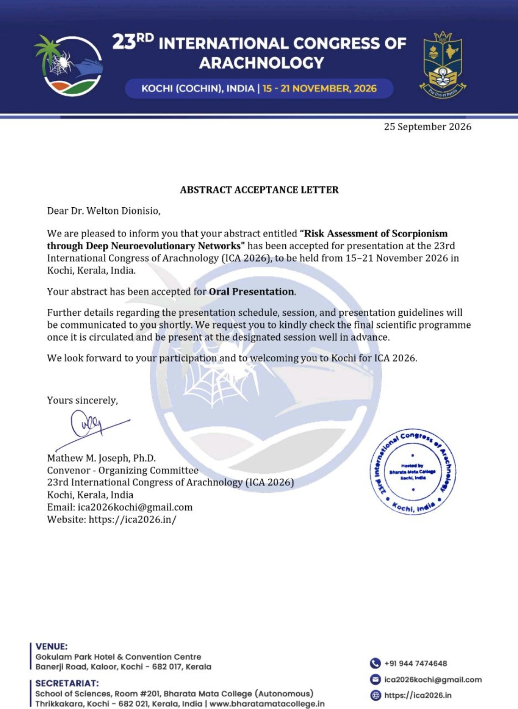

# Sistema ANTARES (Automated Neuroevolutionary Tool for Anticipating Risk of Envenomation by Scorpions)

Uma Ferramenta Neuroevolutiva Automatizada para Antecipar o Risco de Envenonamento por Escorpiões. 
Autor: Dr. Welton Dionisio-da-Silva (Universidade de São Paulo). CV Lattes: http://lattes.cnpq.br/5824616728541618 
Financiamento: São Paulo Research Foundation (FAPESP), Brazil, process number #2024/07110-0. 
Disponível em: https://antares-sistema.streamlit.app/

<h2>🌍 Apresentação científica em Congresso Internacional — ICA 2026</h2>

<strong>Resumo aceito para apresentação oral em congresso internacional</strong>:
23rd International Congress of Arachnology (ICA 2026),
Kochi, India, 15–21 November 2026.

<strong>Title:</strong>
<em>Risk Assessment of Scorpionism through Deep Neuroevolutionary Networks</em>

  

